```mermaid
flowchart LR
    A(["Start: Linux ELF binary"]) --> B["Identify & triage<br/>file · strings · sha256sum · checksec · binwalk"]
    B --> C["Inspect ELF structure<br/>readelf · elfutils · nm · objdump · XELFViewer<br/><small>Headers · sections · symbols · relocations · imports</small>"]

    C --> S0
    C --> D0

    subgraph STATIC["Static analysis"]
        direction TB
        S0["Disassemblers<br/>GNU objdump · LLVM objdump · radare2 / Cutter<br/>Ghidra · IDA Free · Binary Ninja · Hopper<br/>Rizin · REDasm · ndisasm · Capstone"]

        S0 --> S1["Decompilers<br/>Ghidra · RetDec · Hex-Rays · Binary Ninja<br/>Hopper · Snowman · angr decompiler"]

        S1 --> S2["Code and graph analysis<br/>Ghidra · radare2 / Cutter · angr · BAP<br/><small>CFG · call graph · data flow · symbolic execution</small>"]
    end

    subgraph DYNAMIC["Dynamic analysis"]
        direction TB
        D0["Debuggers<br/>GDB · LLDB · rr · radare2<br/>GEF · pwndbg · peda · gdb-dashboard"]

        D0 --> D1["System and library tracing<br/>strace · ltrace · perf · bpftrace<br/>SystemTap · ftrace · valgrind"]

        D1 --> D2["Runtime inspection<br/>Frida · QBDI · DynamoRIO · Intel Pin<br/>gcore · pmap · procfs"]
    end

    S0 <-. "Cross-check static and runtime evidence" .-> D0

    S2 --> E["Correlate findings<br/>Functions · data structures · syscalls · behavior"]
    D2 --> E

    E --> F["Binary patching and editing<br/>radare2 / Cutter · Ghidra · LIEF · patchelf<br/>hexedit · wxHexEditor · ImHex"]

    F --> G(["Document results<br/>Annotated pseudocode · CFGs · call graphs · report"])

    G --> H["Safety<br/>Analyze only authorized software.<br/>Run unknown binaries in an isolated VM or sandbox.<br/>Do not upload sensitive binaries to online services."]

    classDef startEnd fill:#102a43,stroke:#32d5ff,color:#ffffff,stroke-width:3px;
    classDef common fill:#142b44,stroke:#3aaeff,color:#ffffff,stroke-width:2px;
    classDef static fill:#10334a,stroke:#32d5ff,color:#ffffff,stroke-width:2px;
    classDef dynamic fill:#261d4d,stroke:#9a72ff,color:#ffffff,stroke-width:2px;
    classDef result fill:#123b3c,stroke:#45e0b7,color:#ffffff,stroke-width:2px;
    classDef safety fill:#202a36,stroke:#718096,color:#e6edf3,stroke-width:1px;

    class A,G startEnd;
    class B,C common;
    class S0,S1,S2 static;
    class D0,D1,D2 dynamic;
    class E,F result;
    class H safety;

    style STATIC fill:#0b2235,stroke:#32d5ff,stroke-width:2px,color:#7ee7ff
    style DYNAMIC fill:#19143a,stroke:#9a72ff,stroke-width:2px,color:#c1adff
```
    

        
    

# **`Awesome`** [Linux](https://wikipedia.org/wiki/Linux) Reverse [Engineering](https://www.reddit.com/r/ReverseEngineering/) 

 

    
    &nbsp;
    
    &nbsp;
    
    

## 📖 Contents
- [ELF File Viewer/Editor](#elf-file-viewereditor)
- [Datasets](#datasets)
- [Scientific Research](#scientific-research)
- [My Other Awesome Lists](#my-other-awesome-lists)
- [Contributing](#contributing)
- [Contributors](#contributors)

## Tools

### [ELF File](https://en.wikipedia.org/wiki/Executable_and_Linkable_Format) Viewer/Editor
- [Online ELF Viewer](https://www.sunshine2k.de/coding/javascript/onlineelfviewer/onlineelfviewer.html) - [Online ELF viewer](https://www.sunshine2k.de/coding_typescript.html#onlineELFviewer) to show the contents ELF files.
- [XELFViewer](https://github.com/horsicq/XELFViewer) - [XELFViewer](https://horsicq.github.io/) is ELF file viewer/editor for Windows, Linux and MacOS.

### [Disassembler](https://en.wikipedia.org/wiki/Disassembler)

- [GNU-objdump](https://man7.org/linux/man-pages/man1/objdump.1.html)

- [LLVM-objdump](https://llvm.org/docs/CommandGuide/llvm-objdump.html)

- [radare2](https://radare2.com/)

- [ndisasm](https://linux.die.net/man/1/ndisasm)

- [RetDec CLI](https://github.com/avast/retdec)

- [Capstone](https://www.capstone-engine.org/)

- [Hopper](https://www.hopperapp.com/)

- [Ghidra](https://github.com/nationalsecurityagency/ghidra)

- [REDasm](https://redasm.dev/)

### [Decompiler](https://en.wikipedia.org/wiki/Decompiler)

### [Debugging](https://en.wikipedia.org/wiki/Debugger) Tools

##

### Datasets
You can access the datasets [here](https://github.com/cybersecurity-dev/awesome-malware-datasets?tab=readme-ov-file#linux).

### Scientific Research
You can access the Scientific Research [here](https://github.com/cybersecurity-dev/awesome-static-linux-malware-analysis-scientific-research).

### My Other Awesome Lists
You can access the my other awesome lists [here](https://cyberthreatdefence.com/my_awesome_lists)

### Contributing
[Contributions of any kind welcome, just follow the guidelines](contributing.md)!

### Contributors
[Thanks goes to these contributors](https://github.com/cybersecurity-dev/awesome-linux-reverse-engineering/graphs/contributors)!

### License

[🔼 Back to top](#awesome-linux-reverse-engineering-)
